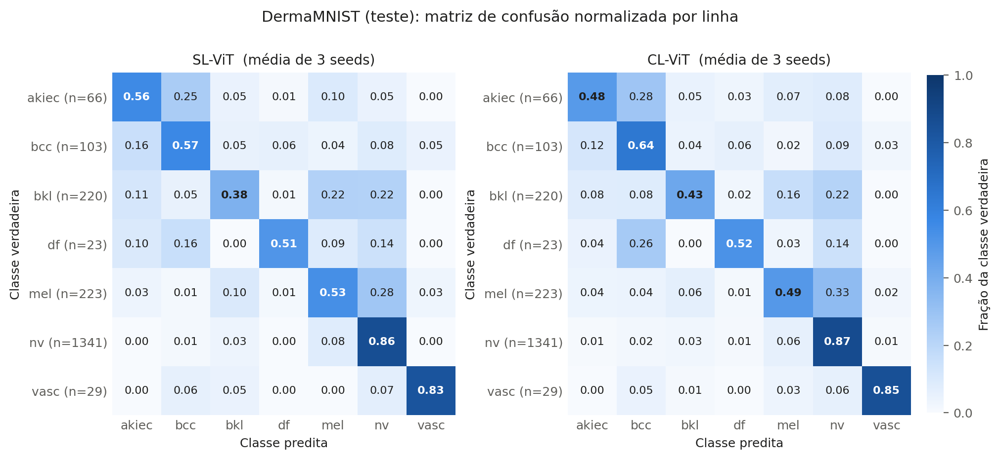

# ViTs com poucos dados em lesões de pele: reprodução de SPT + LSA e um híbrido convolucional (CL-ViT)

Projeto da disciplina **CIN0040 – Introdução à Aprendizagem Profunda** (CIn-UFPE, 2026.2).

> **Este repositório é um fork de [aanna0701/SPT_LSA_ViT](https://github.com/aanna0701/SPT_LSA_ViT)**, o código oficial do artigo *Vision Transformer for Small-Size Datasets* (Lee, Lee e Song, 2021). O código-base e as ideias de SPT e LSA pertencem aos autores originais. O README original está preservado em [`README_original.md`](README_original.md).

## Resumo

Como treinar Vision Transformers do zero com poucos dados, em um problema real de saúde? Reproduzimos os resultados do artigo (SPT + LSA) em CIFAR-100 e Tiny-ImageNet, propomos o **CL-ViT** (um *stem* convolucional no lugar do SPT, com LSA) e avaliamos os modelos também no **DermaMNIST** (lesões de pele, 7 classes, desbalanceado).



## O que foi feito

Todos os modelos (ViT, SL-ViT e CL-ViT) usam a **mesma receita de treino do artigo** (AdamW, warmup + cosine, label smoothing, CutMix, Mixup, AutoAugment, stochastic depth, random erasing, lr 0,003), com o mesmo laço de treino (`utils/engine.py`). O que muda entre eles é só o tokenizador.

1. **Projeto do stem do CL-ViT (CIFAR-100).** Usamos o Optuna (TPE + MedianPruner) para escolher a arquitetura do stem convolucional: nº de canais, crescimento dos canais, conv extra, tipo de projeção final e multiplicador da lr do stem. Cada configuração treinou 30 épocas e foi avaliada numa validação separada do treino (10% estratificado, `splits/`), sem tocar no teste. Stems com mais de 4× os parâmetros ou FLOPs do SPT foram descartados antes de treinar. Foram 25 configurações; as 3 melhores foram retreinadas por 100 épocas e a vencedora virou o stem do CL-ViT em todos os datasets.
2. **Tratamento do desbalanceamento (DermaMNIST).** Para cada modelo, o Optuna buscou a lr, a ponderação das classes na loss (nenhuma, inverso da frequência ou raiz do inverso) e o label smoothing, maximizando o F1 macro na validação oficial. Os três modelos tiveram o mesmo espaço de busca, o mesmo orçamento (20 configurações de 30 épocas) e a mesma seed do sampler, para a comparação ser justa.
3. **Treino final e avaliação.** Com o stem e os hiperparâmetros fixados, cada modelo foi treinado no conjunto de treino completo com 3 seeds (42, 43, 44) e avaliado **uma única vez no teste**. No Tiny-ImageNet não houve busca: o stem é o mesmo escolhido no CIFAR-100. No DermaMNIST, SL-ViT e CL-ViT também foram treinados por 200 épocas, para ver se o treino de 100 épocas estava curto.

O passo a passo para rodar tudo no cluster está em [`docs/pipeline_optuna.md`](docs/pipeline_optuna.md).

## Resultados

Teste, média ± desvio das 3 seeds.

### CIFAR-100 e Tiny-ImageNet (acurácia top-1, %, 100 épocas)

| Modelo | CIFAR-100 | Tiny-ImageNet |
|---|---|---|
| ViT (artigo) | 73,81 | 57,07 |
| SL-ViT (artigo) | 76,92 | 61,07 |
| ViT (nossa reprodução) | 74,15 | 56,86 |
| SL-ViT (nossa reprodução) | 76,48 | 60.07 |
| **CL-ViT (nosso), melhor época** | **75,11 ± 0,26** | **61,95 ± 0,13** |
| CL-ViT (nosso), última época | 74,94 ± 0,40 | 61,87 ± 0,25 |

CL-ViT: 2,85 M params / 198 M FLOPs no CIFAR-100 e 3,30 M / 235 M no Tiny-ImageNet.

- O artigo reporta a **melhor** época no teste (otimista). Para comparar com ele, use a linha "melhor época"; a "última época" é o protocolo limpo.
- No CIFAR-100 o CL-ViT supera o ViT do artigo (+1,3 pp), mas fica abaixo do SL-ViT (−1,8 pp). No Tiny-ImageNet ele fica +0,9 pp acima do SL-ViT do artigo.
- Falta a nossa reprodução do ViT/SL-ViT com o mesmo código para fechar a comparação (os logs parciais estão na branch `treinamento-luma`).

### DermaMNIST (teste, última época)

Cada modelo com os hiperparâmetros escolhidos na busca do item 2 (nos três venceu a ponderação pela raiz do inverso da frequência).

| Modelo | Épocas | F1 macro | AUC | Acc bal. | Recall melanoma | Acc (%) |
|---|---|---|---|---|---|---|
| ViT | 100 | 0,549 ± 0,009 | 0,930 ± 0,001 | 0,609 ± 0,016 | 0,489 ± 0,023 | 74,41 ± 0,84 |
| SL-ViT | 100 | **0,566 ± 0,018** | 0,930 ± 0,003 | 0,604 ± 0,026 | **0,534 ± 0,016** | 74,25 ± 0,10 |
| **CL-ViT** | 100 | 0,561 ± 0,005 | **0,932 ± 0,001** | **0,614 ± 0,008** | 0,493 ± 0,016 | **75,41 ± 0,41** |
| SL-ViT | 200 | **0,585 ± 0,008** | 0,919 ± 0,004 | 0,607 ± 0,008 | 0,520 ± 0,008 | 75,38 ± 0,37 |
| **CL-ViT** | 200 | 0,581 ± 0,016 | **0,927 ± 0,003** | **0,618 ± 0,026** | **0,552 ± 0,024** | **75,93 ± 0,15** |

- **SL-ViT e CL-ViT empatam no F1** (diferença menor que 1 desvio). O CL-ViT tem acurácia, AUC e acurácia balanceada um pouco maiores e é bem mais estável entre seeds; o SL-ViT reconhece um pouco mais de melanoma em 100 épocas. Os dois superam o ViT.
- **200 épocas** sobem o F1 em ~0,02 nos dois modelos, mas a AUC cai e a loss de teste volta a subir depois da época ~100–120 (início de overfitting; ver [`figures/derma_loss_100_vs_200ep.png`](figures/derma_loss_100_vs_200ep.png)).
- O erro dominante é **melanoma previsto como nevo** (28–33% dos melanomas) e ceratose benigna confundida com melanoma/nevo (figura acima).

### Busca de hiperparâmetros (validação)

- **Stem do CL-ViT** (CIFAR-100): 48 canais dobrando a cada conv de stride 2, conv extra, projeção linear e `stem_lr_mult ≈ 0,79` ([`configs/cl_vit_stem_final.yaml`](configs/cl_vit_stem_final.yaml)). 74,16% na validação; ganha do stem original da proposta por só +0,6 pp (dentro do ruído), mas com **14% menos parâmetros** no stem.
- **Desbalanceamento** (DermaMNIST): a ponderação pela raiz do inverso da frequência venceu nos três modelos. Sem ponderação a acurácia sobe, mas o recall de melanoma cai para 0,08–0,29.

Tabelas completas dos trials e cuidados na interpretação: [`docs/busca_hiperparametros.md`](docs/busca_hiperparametros.md). Os journals do Optuna estão em `optuna_storage/` e os logs do Slurm de cada job em `logs/`.

> **Throughput:** os jobs caíram em GPUs diferentes (RTX 3090, A100 inteira e fatias MIG da A100), então img/s e tempo de treino **não** são comparáveis entre modelos.

## O que é nosso e o que é original

| Parte | Origem |
|---|---|
| `main.py`, `models/` (ViT, SPT, LSA), `utils/` (receita de treino) | Código original dos autores |
| `models/vit.py` (stem convolucional / CL-ViT, `--is_CL`) | Nossa contribuição |
| `utils/dataloader.py` (DermaMNIST, Tiny-ImageNet sem reorganizar) | Nossa adaptação |
| `optuna_*.py`, `confirm_top_stems.py`, `final_train.py`, `utils/{engine,pipeline,cli,cost,splits}.py` | Nossa contribuição (pipeline Optuna) |
| `slurm/`, `scripts/`, `notebooks/`, `results/`, `figures/` | Nossa contribuição |

## Estrutura

```
main.py, models/, utils/        código-base (autores) + nossas alterações
optuna_stem_search.py           busca do stem do CL-ViT (CIFAR-100)
confirm_top_stems.py            retreina os 3 melhores stems -> configs/cl_vit_stem_final.yaml
optuna_derma_search.py          busca do tratamento de desbalanceamento (DermaMNIST)
final_train.py                  treino final, 3 seeds, avaliação no teste
configs/                        espaço de busca e stem final
splits/                         índices da validação do CIFAR-100
slurm/                          jobs do cluster Apuana (CIn-UFPE); script.sh = treino avulso via main.py
scripts/                        summarize.py (relatório), plot_confusion.py, plot_loss_epochs.py
optuna_storage/                 journals dos studies do Optuna (lidos pelo final_train.py)
results/                        um diretório por trial/run (config, histórico, métricas)
logs/                           logs do Slurm dos jobs usados nos resultados
figures/                        figuras do relatório
reports/                        saída do scripts/summarize.py (tabelas, trials, importância, histórico das buscas)
docs/                           passo a passo do pipeline e tabelas completas das buscas de hiperparâmetros
notebooks/                      EDA dos três datasets
```

## Como reproduzir

```bash
git clone <URL-DESTE-REPOSITORIO>
cd <pasta>
python -m venv venv && source venv/bin/activate
```

**1. PyTorch com CUDA.** `torch` e `torchvision` ficam fora do `requirements.txt` porque o wheel certo depende da versão de CUDA da máquina. Veja a versão máxima suportada pelo driver no canto superior direito de `nvidia-smi` e escolha o índice correspondente (lista completa em <https://pytorch.org/get-started/locally/>):

```bash
# CUDA 12.6
pip install torch torchvision --index-url https://download.pytorch.org/whl/cu126
# CUDA 13.0
pip install torch torchvision --index-url https://download.pytorch.org/whl/cu130
# só CPU
pip install torch torchvision --index-url https://download.pytorch.org/whl/cpu

# confira se a GPU foi reconhecida
python -c "import torch; print(torch.__version__, torch.cuda.is_available())"
```

**2. Demais dependências e execução.** Instale o torch primeiro: assim o `pip` não troca o wheel CUDA por outro ao resolver `timm`, `torchsummary` etc.

```bash
pip install -r requirements.txt
# exemplo (confira os argumentos com: python main.py --help)
python main.py --model vit --dataset CIFAR100 --lr 0.003
python main.py --model vit --dataset CIFAR100 --lr 0.001 --is_SPT --is_LSA
```

Para rodar o pipeline completo no Slurm, veja [`docs/pipeline_optuna.md`](docs/pipeline_optuna.md). O treino final de um modelo, por exemplo:

```bash
python final_train.py --model cl_vit --dataset dermamnist --seed 42 --params-from study:phase2_derma_cl_vit
```

O relatório (tabelas, importância de hiperparâmetros, gráficos) sai de `python scripts/summarize.py --storage-dir optuna_storage --results-dir results --out reports`.

## Equipe

- Giovanna Marques Mafra
- Luma Rios Ferreira
- Mariana Sousa Freire

Professor: Tsang Ing Ren.

## Créditos e citação

Se usar este trabalho, cite também o artigo original:

```bibtex
@article{lee2021vision,
  title   = {Vision Transformer for Small-Size Datasets},
  author  = {Lee, Seung Hoon and Lee, Seunghyun and Song, Byung Cheol},
  journal = {arXiv preprint arXiv:2112.13492},
  year    = {2021}
}
```

Outras fontes: MedMNIST v2 (DermaMNIST), HAM10000, CIFAR-100 e Tiny-ImageNet (ver a proposta/relatório do projeto).
